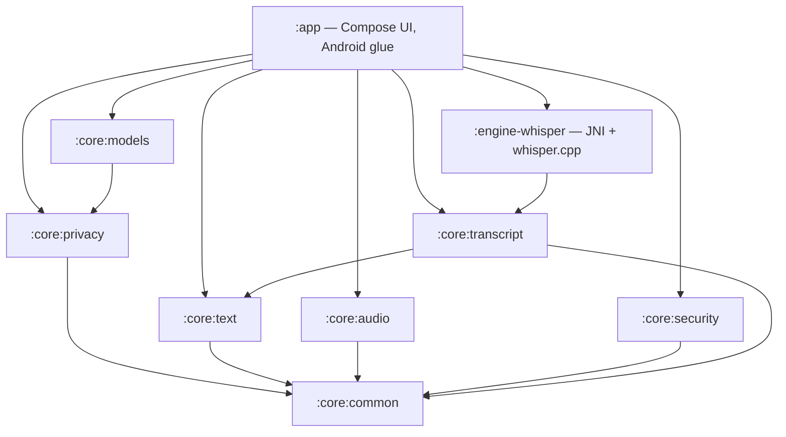
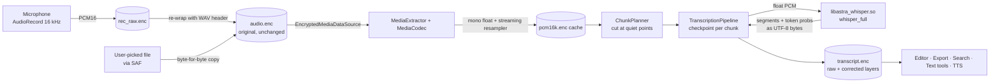
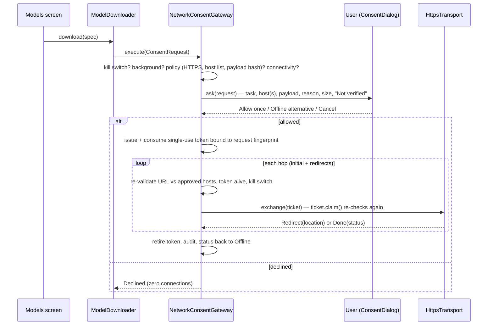

# Architecture

## Modules

All `core:*` modules are plain Kotlin/JVM with no Android dependency, so the privacy-critical and
accuracy-critical logic is unit-testable anywhere. Android-specific code lives in `:app` packages:

| Spec module | Where it lives |
|---|---|
| App UI | `app/…/ui`, `ui/screens` |
| Audio capture / playback | `app/…/audio/Recorder.kt`, `Player.kt` |
| File import / export | `core/text/DocumentImport.kt`, `app/…/export/ExportManager.kt`, `storage/Library.kt` |
| Transcription engine adapters | `core/transcript/Engine.kt` (interface), `engine-whisper` (whisper.cpp), `app/…/engine/OnDeviceDictation.kt` (Android on-device recognizer) |
| Text-processing adapters | `core/text/*` (deterministic tools) |
| Local model manager | `core/models/*`, `app/…/engine/EngineManager.kt` |
| Local search / index | `core/text/SearchIndex.kt` (in-memory, rebuilt from encrypted library) |
| Privacy / consent gateway | `core/privacy/*`, `app/…/net/HttpsTransport.kt`, `privacy/ConsentBridge.kt` |
| Encrypted storage | `core/security/StreamingAead.kt`, `app/…/security/KeystoreKeyWrapper.kt`, `storage/Library.kt` |
| Audit log | `core/privacy/Audit.kt`, `app/…/privacy/FileAuditLog.kt` |
| Settings | `app/…/settings/Settings.kt` |
| Test harness | `*/src/test`, `app/src/androidTest`, `scripts/verify-*.sh`, `scripts/compile-check` |

## Transcription data flow

* Plaintext never touches disk: decoding reads through a decrypting `MediaDataSource`, caches are encrypted.
* The **raw** layer is the engine's output and is never edited; user edits and approved glossary
  replacements go into the **corrected** layer with a correction record.
* Each chunk's result is saved in an encrypted checkpoint, so a killed process resumes from the next chunk.

## Network consent sequence

## Key decisions

See [adr/](adr/) for the decision records.
